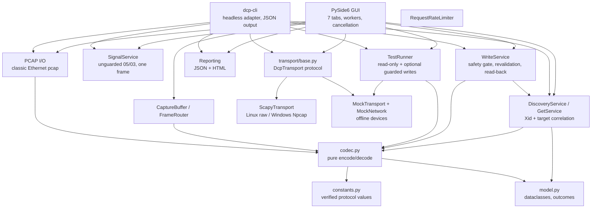

# DCP Studio — Architecture and Implementation Record

Status: **Phases 1–4 implemented, tested and consolidated** (2026-11-14)
Application: `dcpstudio` 0.1.1
Scope of this build: **PROFINET DCP discovery, passive decoding, read-only Get,
unguarded LED Signal, per-operation-confirmed NameOfStation/IP Set, verified
reset variants (RTFS 1/2/4/8 and legacy `05/05`), post-checks, the functional
test runner, diagnostics, PCAP, JSON/HTML reporting, and a headless CLI**

---

## 1. What was verified before coding

### 1.1 Library APIs

| Dependency | Version used | APIs verified |
|---|---|---|
| Python | 3.11.2 (project requires ≥3.11) | — |
| uv | 0.13.7 | `uv sync`, `uv run`, `uv add` |
| Scapy | **2.8.0** (pinned) | `conf.ifaces` entries expose `name`, `description`, `mac`, `ips`, `flags`; `Ether`; `sendp(x, iface=..., verbose=False)`; `AsyncSniffer(iface=..., prn=..., store=False, filter=...)` with `.start()`, `.running`, `.exception`, `.stop(join=False)`, `.thread` |
| PySide6 | **6.12.0** (resolved; constraint `>=6.8,<7`) | Stable QtCore/QtWidgets APIs only: `QApplication`, `QMainWindow`, `QTabWidget`, `QTableWidget`, `QThread`, `Signal`, `QTimer`, `QFileDialog` |

Scapy is used **only** for interface enumeration and raw Layer-2 I/O. DCP
encoding/decoding is implemented explicitly with `struct` from the verified
layouts below. This avoids depending on Scapy having a PROFINET/DCP dissector.

### 1.2 Protocol references

1. **rt-labs p-net** (certified PROFINET device stack), public mirror
   (see [`docs/references.md`](docs/references.md)):
   - `src/common/pf_dcp.h` — option/sub-option enums, control sub-options,
     block errors, device initiative.
   - `src/common/pf_dcp.c` — FrameIDs `0xFEFC…0xFEFF`, 10-byte DCP header,
     4-byte block header + optional BlockInfo/BlockQualifier, alignment
     padding, response-delay formula, SAM 3 s.
   - `src/device/pf_cmina.c` / `.h` — `temp = ((block_qualifier & 1) == 0)`,
     `reset_mode = block_qualifier >> 1`, station-name/IP validation rules,
     reset-mode 1/2/99 behavior.
2. **Wireshark `pn_dcp` dissector**
   `plugins/epan/profinet/packet-pn-dcp.c` (IEC 61158-6-10 §4.3):
   - BlockQualifier `0x0000` temporary / `0x0001` permanent.
   - `ResetToFactory` mode table after `BlockQualifier >> 1`.
   - Device-role bit masks `0x01` IO-Device, `0x02` IO-Controller,
     `0x04` IO-Multidevice, `0x08` PN-Supervisor.
   - Block errors `0x00…0x07`.
3. PROFINET v2.4 *Services* §6.3.11 and *Protocol* §4.3.1.3.5 as cited by those
   implementations (response delay, CMINA state table, name syntax).

Full links and limitations: [`docs/references.md`](docs/references.md).

### 1.3 Consequences encoded in the implementation

- Identify requests contain `FF/FF` with **BlockLength 0** and no BlockQualifier
  (`DCPDataLength` 4), matching the Nmap `multicast-profinet-discovery.nse`
  script and a device on the lab segment. A spurious BlockQualifier
  (`ff ff 00 02 00 00`) is answered only by tolerant implementations.
- An Identify filter by NameOfStation is a single `02/02` block whose value is
  the ASCII name; it has no BlockInfo/BlockQualifier (p-net
  `pf_dcp_identify_req`). Names are matched exactly and case-sensitively.
- **Get requests are just Option/SubOption pairs** — no BlockLength, no
  BlockQualifier (p-net GET branch and Wireshark selector dissection).
- Identify/Get responses carry **BlockInfo** (2 bytes) in each block.
- Set requests carry **BlockQualifier**; Set responses carry **Control/Response**
  with value `[option, suboption, blockError]` and no BlockInfo.
- Blocks are padded to a 16-bit boundary; padding is not included in
  `BlockLength`.
- EtherType `0x8892` also carries PROFINET RT/PTCP/alarms; only FrameIDs
  `0xFEFC…0xFEFF` are DCP.
- ResetToFactorySettings is `05/06`; the wire qualifier is `mode << 1`. Modes
  1, 2, 4 and 8 are transmitted behind the safety gate. Modes 3 and 9 are listed
  by Wireshark but were not verified on hardware and are refused by the encoder.
- Legacy FactoryReset is `05/05` with a 2-byte BlockQualifier; Wireshark reads
  `0x0000` as "Default" and any other value as reserved, and p-net ignores the
  qualifier and performs a full reset (reset mode 99, "reset all"). It is
  transmitted with qualifier `0x0000` behind the same safety gate; there is no
  mode field, so the erased scope cannot be selected.
- DCP Signal is `05/03` with a 2-byte BlockQualifier and a 2-byte SignalValue;
  Wireshark decodes `0x0100` as "Flash once" and p-net ignores both fields and
  only flashes the LED. Because both accept the 4-byte form, Signal is
  implemented with qualifier `0x0000` + SignalValue `0x0100` — as an
  **unguarded** identification action (single unicast frame, rate-limited, no
  retry), not as a state-changing write.

---

## 2. Delivered architecture

### 2.1 Module map

| Module | Responsibility |
|---|---|
| `constants.py` | Verified protocol constants and names; no guessed values |
| `outcomes.py` | Typed outcome vocabulary (`RequestState`, `DiscoveryOutcome`, `Verification`, `PostCheckState`, `TransactionOutcome`, `ResponseVerdict`) and the single display-text table; serializes as the same strings as before |
| `html_render.py` | One Qt-free escaping and table-markup path (`esc`, `cell`, `row`, `empty_row`, `li_items`, `joined`) shared by the report and every GUI summary |
| `model.py` | `DcpFrame`, `DcpBlock`, `DeviceIdentity`, `TransactionRecord`, `DiscoveryResult`, `GetResult`, `WriteResult`, `TestResult`, UTC helpers |
| `codec.py` | Pure builders (Identify, Get, Set Name/IP, Signal, RTFS and legacy reset) and defensive parser |
| `validation.py` | PROFINET name and IPv4 suite validation |
| `interfaces.py` | Domain descriptions of a network interface and capture readiness (`InterfaceInfo`, `Readiness`), plus the mock interface. No I/O, no Qt, no Scapy |
| `transport/base.py` | Transport protocol and callback contract; re-exports the domain interface/readiness models |
| `transport/interfaces.py` | Scapy interface enumeration, link state, CAP_NET_RAW/Npcap checks |
| `transport/scapy_transport.py` | Sniffer-before-send, BPF fallback, raw send, clean shutdown |
| `transport/factory.py` | Choose Scapy or mock transport |
| `mock.py` | Offline mock devices and transport; simulates Set/Reset in memory only |
| `services/rate_limit.py` | Minimum request interval, cancellation-aware |
| `services/capture.py` | Bounded passive capture buffer and frame fan-out |
| `services/correlation.py` | Shared one-request correlation: `PendingRequest`, the common destination/Xid/source/duplicate decision, and the bounded wait/collect loops used by Discovery, Get, Write and Signal |
| `session.py` | Single composition root: builds the transport, router, shared rate limiter and discovery/Get/Write/Signal services for one interface. Used by the GUI, the CLI and the test runner |
| `services/discovery.py` | One-request Identify, Xid/service/target matching, dedupe, late/unrelated handling |
| `services/get.py` | One-request read-only Get, block presets, Xid/target matching, block-error reporting |
| `services/write.py` | Guarded Set/Reset, confirmation, fresh target revalidation, one-shot send, read-back, reset post-check |
| `services/signal.py` | Unguarded DCP Signal (`05/03`): one unicast frame, rate-limited, never retried; result `acknowledged` with `verification="not_attempted"`. Never routed through `WriteService` |
| `testrunner/runner.py` | Run orchestration, service wiring, result helpers and the ID→handler dispatch; the handlers themselves live in `testrunner/handlers/` |
| `testrunner/handlers/` | One mixin per ID namespace (`env`, `parser`, `protocol`, `validation`, `write`); `TestRunner` inherits them, so `getattr(self, f"_test_{id}")` still resolves the handler |
| `testrunner/cases.py` | `TestCase` and the 20-entry `TEST_CASES` catalogue (functional ID namespace: `env.*`, `parser.*`, `protocol.*`, `validation.*`, `write.*`) |
| `pcap_io.py` | Timestamp-preserving classic PCAP write/read |
| `reporting.py` | JSON and escaped HTML reports with limitations/warnings |
| `config.py` | Non-sensitive UI preferences only |
| `logging_setup.py` | Thread-safe structured event log |
| `safety.py` | Configuration-mode gate, per-operation confirmation, safe-maintenance and target-revalidation rules |
| `operations.py` | Guarded-operation catalogue: operator-facing title, parameters, consequences and qualifier for Set Name/IP, RTFS reset and legacy reset. Consumed by the GUI, CLI and test runner; pure (no Qt, no I/O) |
| `fixtures.py` | Synthetic offline frames + provenance; also used by the shipped offline parser tests |
| `utils.py` | Hex dump, JSON default conversion and pretty-printing helpers (no Qt, no I/O) |
| `cli.py` | Headless adapter over the same services: interface listing, Identify, Get, Signal, guarded Set/Reset, read-only functional tests, offline PCAP, JSON output and reports. Guarded commands require `--enable-configuration`, `--confirm` and `--safe-maintenance`; no new wire behaviour |
| `gui/app.py` | Application bootstrap and the close/`deleteLater`/`processEvents` shutdown sequence |
| `gui/workers.py` | `QThread` workers: discovery, Get, Signal, guarded write, reset post-check, test run and PCAP load. The service workers are thin adapters over `SessionController` |
| `gui/confirmation.py` | Per-operation confirmation dialog |
| `gui/presentation.py` | Qt-free rendering helpers (device summary, Get/Write results, report preview) |
| `gui/controller.py` | `SessionController`: session state (interface, transport, services, safety gate, device cache, result histories) and the operations `discover` / `read_get` / `signal` / `execute_write` / `post_check`. Usable without a window |
| `gui/main_window.py` | Window shell: widgets, menu, status bar, tab wiring, session-state properties, configuration persistence and shutdown. It delegates to `SessionController` and to the tab mixins; it holds no tab-specific handler |
| `gui/tabs/` | One construction/**handler** mixin per tab (discovery incl. interface lifecycle, device, configuration, reset, test runner, capture incl. capture lifecycle, logs) plus `write_flow.py` for the guarded Set/Reset flow and the read-only post-check |

### 2.2 Threading and lifecycle

GUI, CLI and test runner obtain their service set from the same composition
root, `session.build_services()`. The GUI supplies its long-lived router and
keeps its own frame fan-out; the CLI and the runner let the root register the
services on a new router. This replaced three copies of the same wiring (see
[`docs/architecture.md`](docs/architecture.md) §5.3).

- GUI thread never performs blocking I/O.
- `DiscoveryWorker(QThread)` runs `DiscoveryService.discover`; cancellation is a
  `threading.Event` checked every 50 ms.
- `GetWorker(QThread)` runs one read-only `GetService.get` transaction.
- `SignalWorker(QThread)` runs one unguarded `SignalService.signal` unicast frame.
- `WriteWorker(QThread)` runs one guarded Set/Reset, including revalidation and
  read-back; `PostCheckWorker(QThread)` runs one read-only reset post-check.
- `TestRunnerWorker(QThread)` runs the test suite; same cancellation event.
- `PcapLoadWorker(QThread)` loads and decodes an offline PCAP without blocking
  the GUI thread.
- Scapy `AsyncSniffer` runs in its own thread. Its callback emits a Qt signal
  through a `CaptureBridge(QObject)`, so parsing/buffer updates occur on the GUI
  thread.
- Capture is started **before** the request is transmitted.
- On window close: cancel event → stop worker with timeout → stop sniffer and
  join its thread (2 s) → close transport. No capture handle or worker survives.
- The CLI is synchronous and single-threaded. It builds the same
  `DiscoveryService`/`GetService`/`WriteService`/`SignalService` set, starts
  capture through the same `DcpTransport`, and closes it in a `finally` block.
  `python -m dcpstudio` still launches the GUI unless the first argument is a
  CLI subcommand.
- One discovery transaction may be pending at a time. No automatic retry and no
  continuous scanning.

### 2.3 Outcome vocabulary

The UI and reports distinguish:

| Outcome | Meaning |
|---|---|
| `transmitted` | The frame was handed to the OS/NIC; no implication of delivery |
| `matching_response_received` | Xid + service + target identity matched |
| `late_response` | Matching response arrived after the configured window |
| `unrelated_response_ignored` | Wrong Xid or wrong unicast target |
| `duplicate_response_ignored` | A second Get response arrived for the same Xid |
| `outcome_unknown` | Timeout; absence of a response is **not** proof of absence/failure |
| `acknowledged` / `rejected` | Device Control/Response verdict; never treated as proof of persistence or reset completion |

A live Set/Reset timeout is reported as outcome unknown, not failure.

---

## 3. Protocol support matrix

The single source of truth for capability status is
[`docs/protocol-support-matrix.md`](docs/protocol-support-matrix.md). It records,
per capability, what is encoded/decoded/sent, what is verified but intentionally
disabled, what is explicitly out of scope, and what remains unverified.

This plan deliberately does not repeat those tables: duplicated capability
matrices drift as soon as one copy is edited. Architecture decisions
(threading, outcome vocabulary, safety controls) stay in §2 and §4 here.

---

## 4. Safety controls in Phases 1–4

| Control | Implementation |
|---|---|
| Read-only default | Configuration mode is OFF; no Set/Reset frame can be transmitted until explicitly enabled |
| Explicit configuration mode | `SafetyGate.configuration_mode` defaults `False`, only enabled with explicit operator authorization |
| Per-operation confirmation | Confirmation dialog shows interface, target MAC, current identity, exact operation/parameters/qualifier, and consequences |
| Authorization and safe-state boxes | Both must be checked; the service re-checks them immediately before sending |
| Target revalidation | Fresh unicast Identify + identity comparison in `WriteService` before any Set/Reset |
| Unicast only | Encoders reject multicast/broadcast MACs; no batch target selector |
| No batch/broadcast | Model fields reject both; no code path exists |
| No automatic retry/rollback | Exactly one Set/Reset; timeout reported as outcome unknown |
| Signal exception | `05/03` stores nothing and interrupts nothing, so it needs no configuration mode; it is still one unicast frame, rate-limited, never retried, and never routed through `WriteService` |
| Cancellation | Before transmission: no frame; after transmission: cancellation does not undo it and the outcome is unknown |
| Independent verification | Name/IP: one read-back Get. Reset: optional read-only post-check (reachability only) |
| Rate limiting | `RequestRateLimiter` default 1.0 s; all reads/writes share it |
| No continuous scanning | Only user-triggered one-shot discovery |
| Missing response ≠ failure | Reported as `outcome_unknown` / inconclusive |
| Isolated lab guidance | README, troubleshooting, and lab integration docs |

---

## 5. Implementation phases

| Phase | Contents | State |
|---|---|---|
| 1 | Interface selection, passive decoding, Identify/unicast Identify, dedupe, transactions, capture, PCAP, reports, mock, tests | **Done** |
| 2 | Read-only Get service and GUI presets, live Get functional test, Get results in reports | **Done** |
| 3 | Guarded Set NameOfStation / Set IP with configuration mode, per-operation confirmation, fresh target revalidation and read-back | **Done** |
| 4 | Verified reset modes 1/2/4/8 and legacy FactoryReset (`05/05`), per-operation confirmation, post-action check | **Done** |

Post-phase consolidation (also complete):

- Headless CLI (`dcp-cli`) over the same services and safety gate.
- DCP Signal (`05/03`) as an unguarded, single-frame identification action.
- Report JSON schema v2 (metadata = application/version only).
- Ruff lint gate with explicit rule selection; `uv run ruff check src tests tools` clean.
- `gui/main_window.py` split into a ~1 400-line controller plus `gui/tabs/`
  mixins; `WriteService.execute` split into named phases; guarded-operation
  text centralised in `operations.py`. A later pass reduced the window shell
  itself to ~380 lines by moving the discovery/capture lifecycles and the
  guarded write flow into the tab mixins (`gui/tabs/write_flow.py`).
- Live validation on an isolated lab segment: read-only paths plus guarded
  Set Name/IP, RTFS modes 2/8 and legacy `05/05`.

All phases retain wire-vector tests, permission/confirmation tests, and
separately documented bench evidence requirements. State-changing coverage has
mock and wire-vector tests; real-device evidence still requires the isolated-lab
procedure.

---

## 6. Known limitations of this deliverable

- Read-only paths and guarded Set/Reset were validated on an isolated lab
  segment with one IO-Device (vendor, model and identifiers withheld); the mock
  and synthetic fixtures provide the only coverage for other devices and for
  Windows/Npcap. See `HANDOFF.md` § *Live hardware run*.
- Windows/Npcap path is implemented from documented Scapy behaviour but was not
  executable on this Linux host.
- Scapy's BPF filter may be unavailable on minimal libpcap builds; the transport
  retries without a kernel filter and filters in Python.
- Report HTML is intentionally dependency-free; it is not a dashboard.
- Timestamps are host-clock based; packet timestamps may come from the driver.
- Vendor-specific device behavior, VLAN topology, and switch multicast filtering
  must be validated on the target lab network.
- Get is sent once per user action. A timeout is reported as outcome unknown;
  devices that require longer SAM spacing or implement Get partially may need a
  longer timeout or per-selector investigation.
- Get presets cover common selector sets; arbitrary Option/SubOption editing is
  not exposed in the GUI.
- Set Name/IP, reset modes 1/2/4/8 and legacy `05/05` were acknowledged by one
  lab device; modes 1 and 4 were rejected by that device with DCP block error
  `0x02`. Device support remains vendor-dependent and a timeout is outcome
  unknown.
- Reset acknowledgement is not proof of completion. The post-check proves only
  that the device answered at the same MAC; erased scope and reboot timing are
  vendor-dependent. There is no automatic retry or rollback.
- Target revalidation uses a fresh unicast Identify. A device that ignores
  unicast Identify cannot be configured/reset by this build, even if multicast
  discovery works. This is intentional: the target must be confirmed immediately
  before transmission.
- Modes 3/9 are not transmitted.
